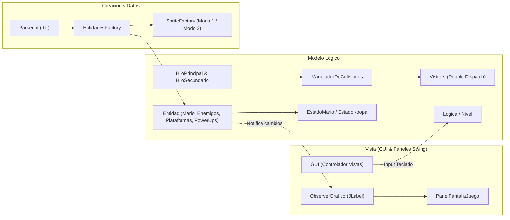

# 🍄 Super Mario Bros — Implementación en Java (POO & Patrones de Diseño)


Recreación 2D de **Super Mario Bros** desarrollada íntegramente en **Java puro (Swing/AWT)** sin motores gráficos externos, como proyecto integrador de la materia **Tecnología de Programación** (Departamento de Ciencias e Ingeniería de la Computación — **Universidad Nacional del Sur**).

Integrantes: Gencarelli Juan, Brandolin Pablo, Reta Santiago, Yerba Agustin y Parisi Bruno

El objetivo principal del proyecto es aplicar principios sólidos de **Programación Orientada a Objetos (POO)**, bajo acoplamiento, alta cohesión y **Patrones de Diseño (GoF)** para resolver problemas clásicos de arquitectura en videojuegos: detección y resolución de colisiones sin chequeos de tipo (`instanceof`), máquinas de estados para entidades dinámicas, carga de niveles orientados a datos y separación estricta entre la lógica de dominio y la interfaz gráfica.

<p align="center">
  
</p>

---

## ✨ Características Principales

- **3 Niveles Jugables Data-Driven:** Cargados dinámicamente mediante un parser de archivos de texto (`NivelMario.txt`, `NivelMario2.txt`, `NivelMario3.txt`), permitiendo diseñar o modificar mapas sin recompilar código.
- **2 Modos Gráficos (Dominios de Sprites):** Selección de temática visual intercambiable en tiempo de ejecución mediante fábricas abstractas.
- **Transformaciones y Estados de Mario:**
  - *Mario Común* → *Super Mario* (capaz de romper ladrillos) → *Mario Fuego* (disparo de bolas de fuego con físicas de rebote) → *Mario Estrella* (invencibilidad temporal con restauración automática al estado previo).
- **6 Tipos de Enemigos con Comportamientos Propios:**
  - **Goomba** y **Buzzy Beetle**: Patrullaje terrestre y aplastamiento.
  - **Koopa Troopa**: Transición a estado de caparazón estático o proyectil pateable que elimina a otros enemigos a su paso.
  - **Lakitu**: Movimiento aéreo con generación periódica de **Spiny** mediante *timers*.
  - **Piranha Plant**: Aparición y ocultamiento cíclico desde las tuberías.
- **Power-Ups e Ítems:** Super Champiñón, Flor de Fuego, Estrella de Invencibilidad, Champiñón Verde (+1 vida) y Monedas (100 monedas = +1 vida).
- **Cámara con Scroll Suave e Interpolación:** Seguimiento horizontal fluido centrado en el jugador.
- **Sistema de Audio Completo:** Música de fondo por nivel/estado y efectos de sonido (`.wav`) administrados mediante `javax.sound.sampled`.
- **Ranking Top 5 Persistente:** Almacenamiento de mejores puntajes en archivo (`TOP5.csv`) gestionado con cola de prioridad (`PriorityQueue`).

---

## 🏗️ Arquitectura y Patrones de Diseño Aplicados

El proyecto separa estrictamente el **Modelo Lógico** de la **Vista (Swing)** a través de interfaces de solo lectura (`EntidadLogica`, `EntidadJugador`) y controladores dedicados.



### Patrones de Diseño Destacados

| Patrón | Implementación en el Proyecto | Propósito / Problema que Resuelve |
| :--- | :--- | :--- |
| **Visitor (Double Dispatch)** | `Visitable`, `Visitor`, `VisitorMario`, `VisitorEnemigo`, `VisitorPlataforma`, `VisitorPowerUp`, etc. | Resuelve las colisiones polimórficamente entre pares de entidades (`entidad1.aceptar(entidad2.getVisitor(), dir)`) eliminando por completo el uso de `instanceof` o *downcasting*. |
| **State** | `EstadoMario` (`Comun`, `SuperMario`, `MarioFuego`, `MarioEstrella`) y `EstadoKoopaTroopa` (`Normal`, `Caparazon`) | Encapsula el comportamiento dependiente del estado (recibir daño, disparar, romper bloques, tamaño de hitbox y desplazamiento de sprites) evitando condicionales complejos en `Mario` y `KoopaTroopa`. |
| **Observer** | `Observer`, `ObserverGrafico`, `ObserverEntidades`, `ObserverJugador` | Desacopla las entidades lógicas de su representación en `Swing` (`JLabel`). Cada vez que una entidad cambia su posición o estado en el bucle lógico, notifica a su observador gráfico para actualizar el renderizado y la cámara. |
| **Abstract Factory & Factory Method** | `SpriteFactory` (`SpritesMarioModo1`, `SpritesMarioModo2`) y `EntidadesFactory` | Permite instanciar familias completas de sprites según el modo de juego elegido sin acoplar las entidades ni el *parser* de niveles a rutas de imágenes concretas. |
| **Singleton / Mediator** | `ManejadorEntidades` | Centraliza la creación y eliminación dinámica de entidades en tiempo de ejecución (bolas de fuego disparadas, *Spinys* arrojados por Lakitu, ítems que emergen de bloques de pregunta) coordinando el nivel lógico y el registro de observadores en la GUI. |
| **Adapter** | `AdaptadorPosicionPixel` | Traduce las coordenadas cartesianas utilizadas en el motor físico ($Y = 0$ en el suelo, $Y > 0$ hacia arriba) al sistema de coordenadas de píxeles de `Swing` ($Y = 0$ en el borde superior de la ventana). |
| **Strategy** | `ComparadorJugador` | Define el criterio de ordenamiento inyectado en la `PriorityQueue<Jugador>` para mantener el ranking histórico de puntajes (`TopPuntaje`). |

### Diagramas UML

En el directorio [`Diagramas/`](Diagramas/) se encuentran disponibles los diagramas de clases finales del proyecto:
- 📄 [**Diagrama de Clases Reducido (Vista General)**](Diagramas/Diagrama-reducido-defensa-Final.pdf)
- 📄 [**Diagrama de Clases Extendido (Completo)**](Diagramas/Diagrama-extendido-defensa-Final.pdf)

---

## 🎮 Controles

| Tecla | Acción |
| :---: | :--- |
| **`A`** | Moverse a la izquierda |
| **`D`** | Moverse a la derecha |
| **`W`** | Saltar |
| **`Espacio`** | Disparar bola de fuego *(solo en estado Mario Fuego)* |

---

## 📂 Estructura del Proyecto

```text
├── Diagramas/                # Diagramas de clases UML y diagramas de secuencia
├── src/
│   ├── Launcher/             # Punto de entrada de la aplicación (Launcher.java)
│   ├── Logica/               # Coordinador general, hilos de juego, colisiones y sonidos
│   ├── Entidades/            # Jerarquía base de entidades, Mario, hitboxes y manejador dinámico
│   ├── Estados/              # Máquinas de estados de Mario y Koopa Troopa (Patrón State)
│   ├── Enemigos/             # Goomba, KoopaTroopa, Lakitu, Spiny, BuzzyBeetle, PiranhaPlant, BolaDeFuego
│   ├── Plataformas/          # BloqueSolido, LadrilloRompible, BloquePregunta, Tuberia, Meta, Vacio
│   ├── PowerUps/             # SuperChampinion, FlorDeFuego, Estrella, ChampinionVerde, Moneda
│   ├── Visitors/             # Resolución de colisiones por Double Dispatch (Patrón Visitor)
│   ├── Fabricas/             # Fábricas de entidades y de sprites por temática (Abstract Factory)
│   ├── Nivel/                # Modelo del nivel actual y fondo (Silueta)
│   ├── ParseInt/             # Parser generador de niveles desde archivos de texto
│   ├── Niveles/              # Archivos .txt de configuración de los 3 niveles y documentación de formato
│   ├── Puntaje/              # Gestión y persistencia del Top 5 de jugadores (TOP5.csv)
│   ├── GUI/                  # Ventana principal, controladores de vista, adaptador y Observers gráficos
│   ├── Paneles/              # Pantallas de menú, selección de modo, juego, HUD, victoria y game over
│   ├── Imagenes/             # Sprites (Modo 1 y Modo 2) y fondos de interfaz
│   └── Sonidos/              # Pistas musicales y efectos de sonido (.wav)
└── TOP5.csv                  # Registro persistente de los 5 mejores puntajes
```

---

## 🚀 Ejecución Local

### Requisitos previos
- **Java JDK 17** o superior (compatible desde JDK 11+).

### Compilar y ejecutar desde terminal

1. Clonar el repositorio:
   ```bash
   git clone https://github.com/JuanseGenca/SuperMario-Java.git
   cd SuperMario-Java
   ```

2. Compilar el código fuente y copiar los recursos a la carpeta `bin/`:
   ```bash
   mkdir -p bin
   javac -encoding UTF-8 -d bin $(find src -name "*.java")
   cp -r src/Imagenes src/Sonidos src/Niveles bin/
   ```
   *(En Windows PowerShell)*:
   ```powershell
   New-Item -ItemType Directory -Force -Path bin
   $files = Get-ChildItem -Path src -Filter *.java -Recurse | ForEach-Object { $_.FullName }
   javac -encoding UTF-8 -d bin $files
   Copy-Item -Path src\Imagenes, src\Sonidos, src\Niveles -Destination bin -Recurse -Force
   ```

3. Ejecutar el juego desde la raíz del proyecto:
   ```bash
   java -cp bin Launcher.Launcher
   ```

> **Nota para IDEs (Eclipse / IntelliJ IDEA / VS Code):** Importar el directorio como proyecto Java marcando `src` como *Source Folder* y ejecutar directamente la clase [`src/Launcher/Launcher.java`](src/Launcher/Launcher.java).

